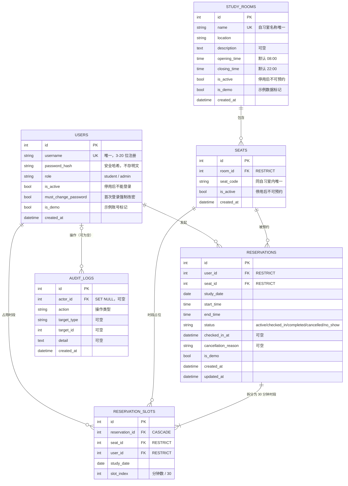
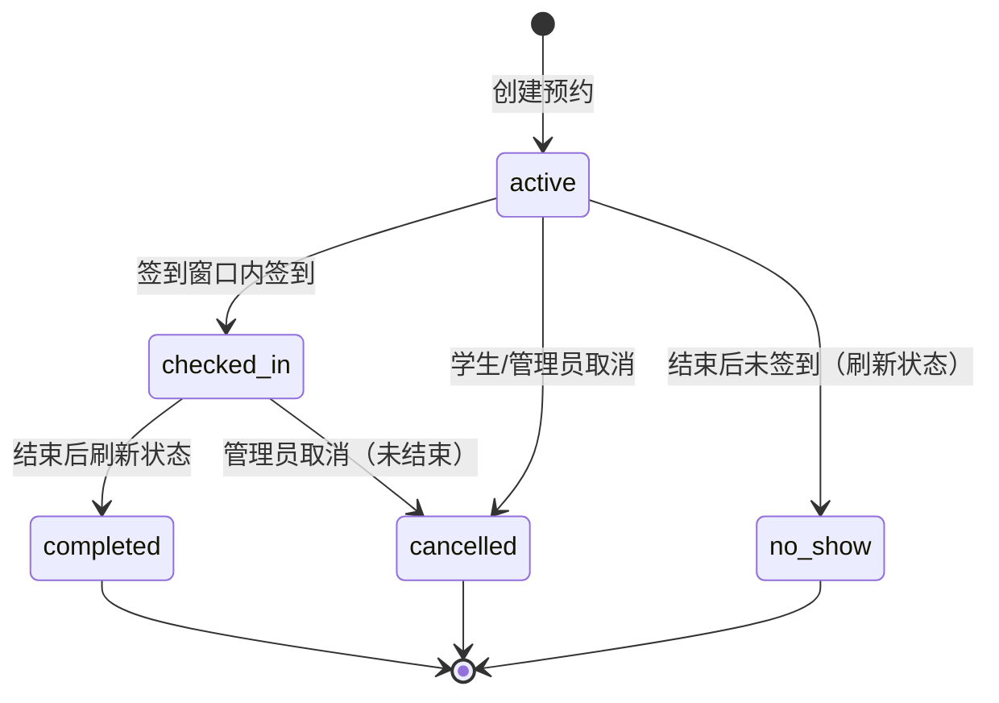
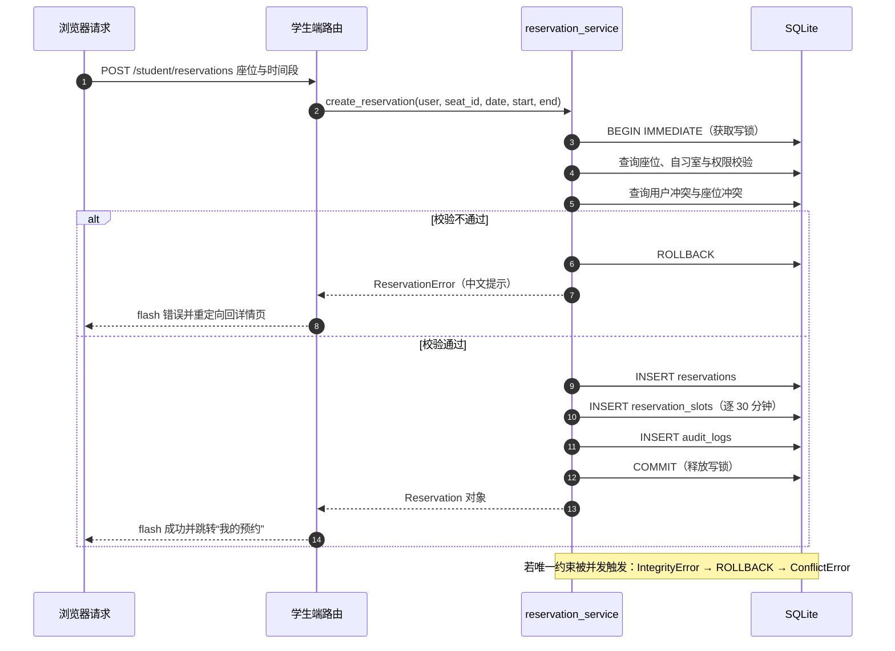

# 数据库设计文档 — 校园自习室智能预约与座位管理系统

> **文档状态**：第一版（与 `app/models/*.py` 实际代码同步）
> **编写日期**：2026-10-25
> **数据库**：SQLite 3（文件数据库，默认 `instance/campus.db`）
> **ORM**：SQLAlchemy 2.0 + Flask-SQLAlchemy 3.1
> **初始化方式**：`flask init-db`（内部为 `db.create_all()`，幂等；`flask create-admin` 也会在需要时自动建表）

---

## 1. 设计目标与原则

1. **结构清晰**：用户、自习室、座位、预约、预约时段占位、审计日志六类实体，职责单一。
2. **约束前置**：能由数据库保证的完整性（唯一性、外键引用、状态枚举、时间顺序）尽量用约束表达，应用层只做业务规则与友好提示。
3. **不可删除历史**：自习室/座位/用户一旦产生历史预约，不允许物理删除，只能停用（外键使用 `RESTRICT`）。
4. **并发安全**：SQLite 不支持 PostgreSQL 的排他约束，因此采用“**`BEGIN IMMEDIATE` 写锁事务 + 预约时段占位表唯一约束**”双层方案，详见第 6 节。
5. **可审计**：关键操作写入 `audit_logs`，便于问题追溯。
6. **不虚构数据**：所有示例数据带 `is_demo` 标记，统计只基于真实数据库记录计算。

> 说明：第一版使用 `db.create_all()` 完成建表，未引入 Flask-Migrate。表结构变更需要手工迁移（已知限制，见第 8 节）。

## 2. 数据库总体信息

| 项目 | 说明 |
|---|---|
| 数据库类型 | SQLite 3 |
| 默认文件 | `instance/campus.db`（由 `app/config.py` 的 `DEFAULT_DATABASE_URI` 指向项目根下 `instance/campus.db` 绝对路径） |
| 连接参数 | `connect_args={"timeout": 30, "check_same_thread": False}` |
| 连接级 PRAGMA | `foreign_keys=ON`、`busy_timeout=30000`、`journal_mode=WAL` |
| 事务开始方式 | 每个事务执行 `BEGIN IMMEDIATE`（获取 RESERVED 写锁），见 `app/extensions.py` |
| 时间存储 | `DATE`/`TIME`/`DATETIME` 均存本地时间（naive，无时区转换） |
| 布尔值 | SQLite 中以整数 0/1 存储 |
| 字符集 | UTF-8 |
| 表数量 | 6 张：`users`、`study_rooms`、`seats`、`reservations`、`reservation_slots`、`audit_logs` |
| 主键策略 | 全部为自增整数主键 `id` |

## 3. ER 图（Mermaid）

> 下图为逻辑模型示意，字段类型使用通用类型名（`int`/`string`/`bool`/`datetime`），实际 SQLite 存储类型见第 4 节各表字段说明。



关系说明：

| 关系 | 基数 | 说明 |
|---|---|---|
| `users` → `reservations` | 1 : N | 一个用户可有多条预约；预约必须属于一个用户（`user_id` 非空，`RESTRICT`） |
| `study_rooms` → `seats` | 1 : N | 一个自习室包含多个座位；座位必须属于一个自习室（`room_id` 非空，`RESTRICT`） |
| `seats` → `reservations` | 1 : N | 一个座位可被多次预约；预约必须指向一个座位（`seat_id` 非空，`RESTRICT`） |
| `reservations` → `reservation_slots` | 1 : 1..N | 一条预约按其时长拆成若干 30 分钟占位行；删除预约时占位行级联删除（`CASCADE`） |
| `users` → `reservation_slots` | 1 : N | 占位行冗余记录 `user_id`，用于“同一用户同一时段唯一”约束 |
| `seats` → `reservation_slots` | 1 : N | 占位行冗余记录 `seat_id`，用于“同一座位同一时段唯一”约束 |
| `users` → `audit_logs` | 0..1 : N | 审计日志的操作者可为空（如系统任务）；用户删除后置空（`SET NULL`） |

## 4. 表结构详解

> 类型写法参照实际建表 SQL（SQLite）：`INTEGER`、`VARCHAR(n)`、`TEXT`、`BOOLEAN`、`DATE`、`TIME`、`DATETIME`。
> “可空”列为 YES 表示允许 NULL；“默认”为应用层默认值（由 SQLAlchemy `default=` 生成，建表 SQL 中不出现数据库级 DEFAULT）。

### 4.1 `users` — 用户表

**用途**：保存学生与管理员账号。普通注册入口只能创建 `student`；管理员账号由 CLI 命令创建。

| 字段 | 类型 | 可空 | 默认 | 约束/说明 |
|---|---|---|---|---|
| `id` | INTEGER | NO | 自增 | 主键 |
| `username` | VARCHAR(32) | NO | — | 用户名；**唯一**（唯一索引 `ix_users_username`）；登录、展示使用 |
| `password_hash` | VARCHAR(256) | NO | — | `werkzeug.security.generate_password_hash` 生成的安全哈希（当前环境为 scrypt，带随机盐），禁止存明文 |
| `role` | VARCHAR(16) | NO | `student` | 角色：`student` / `admin`；普通索引 `ix_users_role` |
| `is_active` | BOOLEAN | NO | `1` | 账号是否启用；停用后登录被拒绝，已登录会话会被强制退出 |
| `must_change_password` | BOOLEAN | NO | `0` | 首次登录是否强制修改密码（演示管理员种子账号为 `1`） |
| `is_demo` | BOOLEAN | NO | `0` | 是否为示例账号（页面展示“示例账号”标记） |
| `created_at` | DATETIME | NO | 当前时间 | 注册/创建时间 |

**约束与索引**

- 主键：`id`
- 唯一索引：`ix_users_username`（`username`）
- 普通索引：`ix_users_role`（`role`）
- 应用层规则：注册用户名字符集 `^[A-Za-z0-9_]+$`、长度 3–20；密码长度 8–64；管理员密码强度校验见 `seed_service.create_admin_account()`。

**删除策略**：`users` 是唯一没有被其他表级联删除引用的根表；由于 `reservations.user_id`、`reservation_slots.user_id` 为 `RESTRICT`，有预约记录的用户不能被删除；`audit_logs.actor_id` 为 `SET NULL`，用户删除后审计记录保留但操作者置空。第一版没有提供删除用户的功能。

### 4.2 `study_rooms` — 自习室表

| 字段 | 类型 | 可空 | 默认 | 约束/说明 |
|---|---|---|---|---|
| `id` | INTEGER | NO | 自增 | 主键 |
| `name` | VARCHAR(50) | NO | — | 自习室名称；**唯一**（唯一索引 `ix_study_rooms_name`） |
| `location` | VARCHAR(100) | NO | — | 位置 |
| `description` | TEXT | YES | NULL | 简介，可空 |
| `opening_time` | TIME | NO | `08:00:00` | 开放时间 |
| `closing_time` | TIME | NO | `22:00:00` | 闭馆时间（应用层校验必须晚于开放时间） |
| `is_active` | BOOLEAN | NO | `1` | 是否启用；停用后学生不可预约 |
| `is_demo` | BOOLEAN | NO | `0` | 是否为示例数据 |
| `created_at` | DATETIME | NO | 当前时间 | 创建时间 |

**约束与索引**

- 主键：`id`
- 唯一索引：`ix_study_rooms_name`（`name`）
- 普通索引：`ix_study_rooms_is_active`（`is_active`）
- 应用层校验：名称 2–50 字符、位置必填且 ≤100 字符、简介 ≤500 字符、闭馆时间晚于开放时间（`RoomForm.validate_closing_time`）

**删除策略**：`seats.room_id` 外键为 `ON DELETE RESTRICT`。有座位的自习室不能删除；系统本身也不提供删除自习室功能，只能启用/停用。

### 4.3 `seats` — 座位表

| 字段 | 类型 | 可空 | 默认 | 约束/说明 |
|---|---|---|---|---|
| `id` | INTEGER | NO | 自增 | 主键 |
| `room_id` | INTEGER | NO | — | 外键 → `study_rooms.id`，`ON DELETE RESTRICT`；普通索引 `ix_seats_room_id` |
| `seat_code` | VARCHAR(20) | NO | — | 座位编号（如 `A-01`）；**同一自习室内唯一** |
| `is_active` | BOOLEAN | NO | `1` | 是否启用；停用后不可预约 |
| `created_at` | DATETIME | NO | 当前时间 | 创建时间 |

**约束与索引**

- 主键：`id`
- 唯一约束：`uq_seats_room_id_seat_code`（`room_id`, `seat_code`）——同一自习室内编号唯一，不同自习室可重复
- 普通索引：`ix_seats_room_id`（`room_id`）、组合索引 `ix_seats_room_id_is_active`（`room_id`, `is_active`）
- 应用层规则：座位编号 1–20 字符，只允许字母、数字、下划线、短横线（`SeatForm`）

**删除策略**：`reservations.seat_id`、`reservation_slots.seat_id` 外键均为 `ON DELETE RESTRICT`。存在历史预约的座位**不允许物理删除**，只能通过 `is_active=False` 停用；系统也未提供删除座位功能。

### 4.4 `reservations` — 预约表

| 字段 | 类型 | 可空 | 默认 | 约束/说明 |
|---|---|---|---|---|
| `id` | INTEGER | NO | 自增 | 主键 |
| `user_id` | INTEGER | NO | — | 外键 → `users.id`，`ON DELETE RESTRICT`；普通索引 `ix_reservations_user_id` |
| `seat_id` | INTEGER | NO | — | 外键 → `seats.id`，`ON DELETE RESTRICT`；普通索引 `ix_reservations_seat_id` |
| `study_date` | DATE | NO | — | 预约日期；普通索引 `ix_reservations_study_date` |
| `start_time` | TIME | NO | — | 开始时间（30 分钟对齐） |
| `end_time` | TIME | NO | — | 结束时间（30 分钟对齐，必须晚于开始时间） |
| `status` | VARCHAR(20) | NO | `active` | 状态枚举：`active` / `checked_in` / `completed` / `cancelled` / `no_show`；普通索引 `ix_reservations_status` |
| `checked_in_at` | DATETIME | YES | NULL | 实际签到时间 |
| `cancellation_reason` | VARCHAR(255) | YES | NULL | 取消原因（学生默认“学生主动取消”；管理员取消必须填写） |
| `is_demo` | BOOLEAN | NO | `0` | 是否为示例数据 |
| `created_at` | DATETIME | NO | 当前时间 | 创建时间 |
| `updated_at` | DATETIME | NO | 当前时间 | 更新时间（`onupdate` 自动维护） |

**Check 约束**

- `ck_reservations_time_order`：`CHECK (end_time > start_time)`
- `ck_reservations_status`：`CHECK (status IN ('active', 'checked_in', 'completed', 'cancelled', 'no_show'))`

**索引**

| 索引名 | 字段 | 用途 |
|---|---|---|
| `ix_reservations_user_id` | `user_id` | 学生查看自己的预约 |
| `ix_reservations_seat_id` | `seat_id` | 座位维度查询 |
| `ix_reservations_study_date` | `study_date` | 按日期筛选 |
| `ix_reservations_status` | `status` | 按状态统计/筛选 |
| `ix_reservations_seat_date_status` | (`seat_id`, `study_date`, `status`) | **座位冲突检查**（核心热路径） |
| `ix_reservations_user_date_status` | (`user_id`, `study_date`, `status`) | **用户冲突检查** |
| `ix_reservations_date_status` | (`study_date`, `status`) | 当日统计、管理端筛选 |

**状态流转**



> 取消/爽约/完成后会清空该预约的 `reservation_slots` 占位行（级联或显式 `slots.clear()`），从而释放座位与用户时间段。

**删除策略**：`reservations` 本身不被级联删除；其从表 `reservation_slots` 的外键为 `ON DELETE CASCADE`（删除预约会一并删除占位行）。第一版不提供删除预约操作，只做状态变更。

### 4.5 `reservation_slots` — 预约时段占位表

**用途**：把一条预约按 30 分钟粒度拆成占位行，通过两个唯一约束在**数据库层**保证同一座位、同一用户在同一时段最多一条有效占位，是并发预约保护的“第二道防线”。

| 字段 | 类型 | 可空 | 默认 | 约束/说明 |
|---|---|---|---|---|
| `id` | INTEGER | NO | 自增 | 主键 |
| `reservation_id` | INTEGER | NO | — | 外键 → `reservations.id`，`ON DELETE CASCADE` |
| `seat_id` | INTEGER | NO | — | 外键 → `seats.id`，`ON DELETE RESTRICT`（冗余自预约，用于唯一约束） |
| `user_id` | INTEGER | NO | — | 外键 → `users.id`，`ON DELETE RESTRICT`（冗余自预约，用于唯一约束） |
| `study_date` | DATE | NO | — | 预约日期（冗余） |
| `slot_index` | INTEGER | NO | — | 时段序号 = `开始时间分钟数 / 30`（如 09:00 → 18，09:30 → 19） |

**唯一约束**

| 约束名 | 字段 | 含义 |
|---|---|---|
| `uq_slots_seat_date_index` | (`seat_id`, `study_date`, `slot_index`) | **同一座位同一天同一 30 分钟时段最多一条有效占位** |
| `uq_slots_user_date_index` | (`user_id`, `study_date`, `slot_index`) | **同一用户同一天同一 30 分钟时段最多一条占位** |

**索引**

- `ix_slots_reservation_id`（`reservation_id`）：按预约查找/清理占位行
- 两个唯一约束在 SQLite 中各自生成唯一索引

**生命周期**

- 仅 `/active` 与 `checked_in` 状态（`HOLDING_STATUSES`）的预约持有占位行；
- 预约创建时按 `range(start_minutes // 30, end_minutes // 30)` 逐行插入；
- 取消、爽约、完成时删除占位行（`slots.clear()` 或级联删除），座位随之释放。

### 4.6 `audit_logs` — 审计日志表

| 字段 | 类型 | 可空 | 默认 | 约束/说明 |
|---|---|---|---|---|
| `id` | INTEGER | NO | 自增 | 主键 |
| `actor_id` | INTEGER | YES | NULL | 外键 → `users.id`，`ON DELETE SET NULL`；系统任务可为空；普通索引 `ix_audit_logs_actor_id` |
| `action` | VARCHAR(50) | NO | — | 操作类型（如 `auth.login`、`reservation.create`、`reservation.cancel`、`reservation.export_csv`）；普通索引 `ix_audit_logs_action` |
| `target_type` | VARCHAR(30) | YES | NULL | 对象类型（如 `reservation`、`seat`、`study_room`、`user`） |
| `target_id` | INTEGER | YES | NULL | 对象 ID |
| `detail` | TEXT | YES | NULL | 详情（不记录任何明文密码/敏感凭据） |
| `created_at` | DATETIME | NO | 当前时间 | 记录时间；普通索引 `ix_audit_logs_created_at` |

**当前会写入审计日志的操作**（以代码为准）：

`auth.login`、`auth.change_password`、`reservation.create`、`reservation.cancel`、`reservation.cancel.admin`、`reservation.check_in`、`reservation.sweep`、`reservation.export_csv`、`room.create`、`room.update`、`room.toggle`、`seat.create`、`seat.update`、`seat.toggle`。

> 审计日志目前只写入数据库，未提供查看界面（已知限制）。

## 5. 外键与删除策略汇总

| 从表.字段 | 引用 | 删除策略 | 设计理由 |
|---|---|---|---|
| `seats.room_id` | `study_rooms.id` | `RESTRICT` | 有座位的自习室不可删除，保留历史结构 |
| `reservations.user_id` | `users.id` | `RESTRICT` | 用户有预约记录时不可删除，保留审计链 |
| `reservations.seat_id` | `seats.id` | `RESTRICT` | 座位有历史预约时不可删除，只能停用 |
| `reservation_slots.reservation_id` | `reservations.id` | `CASCADE` | 占位行从属于预约，随预约删除而清理 |
| `reservation_slots.seat_id` | `seats.id` | `RESTRICT` | 占位行不得因座位删除而丢失 |
| `reservation_slots.user_id` | `users.id` | `RESTRICT` | 占位行不得因用户删除而丢失 |
| `audit_logs.actor_id` | `users.id` | `SET NULL` | 审计记录需长期保留，操作者删除后置空 |

> SQLite 连接上启用了 `PRAGMA foreign_keys=ON`（见 `app/extensions.py`），否则外键约束不会生效。

## 6. SQLite 并发预约保护方案（重点）

### 6.1 问题背景

预约冲突的经典错误写法是：

```text
1. SELECT 查询是否存在冲突预约
2. 若不存在，INSERT 新预约
```

在并发下，两个请求可能**同时**通过第 1 步检查，然后都执行第 2 步，导致同一座位同一时段出现两条有效预约。PostgreSQL 可以用 `EXCLUDE USING gist` 排他约束优雅解决，但 SQLite 不支持，因此必须设计适用于 SQLite 的方案。

### 6.2 双层保护方案

**第一层：`BEGIN IMMEDIATE` 写锁事务（应用层串行化）**

`app/extensions.py` 中：

1. 连接建立时设置 `dbapi_connection.isolation_level = None`，关闭 pysqlite 的隐式事务控制；
2. 监听 SQLAlchemy 的 `begin` 事件，对每个事务显式执行 `BEGIN IMMEDIATE`；
3. `BEGIN IMMEDIATE` 会**立即获取 SQLite 的 RESERVED 写锁**，从而使“冲突查询 → 插入预约 → 插入占位行”处于同一个写事务中；
4. 其他并发写请求会在 `busy_timeout=30000`（30 秒）内等待锁，而不是立刻报 `database is locked`；
5. 连接级启用 `PRAGMA foreign_keys=ON` 与 `journal_mode=WAL`（WAL 允许读写并发，进一步降低读者阻塞）。

**第二层：`reservation_slots` 唯一约束（数据库层兜底）**

即使应用层校验因为极端情况被并发穿透，插入占位行时：

- `uq_slots_seat_date_index (seat_id, study_date, slot_index)`：同一座位同一时段只能有一条占位；
- `uq_slots_user_date_index (user_id, study_date, slot_index)`：同一用户同一时段只能有一条占位。

违反约束时 SQLAlchemy 抛出 `IntegrityError`，服务层捕获后回滚事务并转换为用户可读的 `ConflictError`（提示“该座位或时间段刚刚被其他同学预约，请刷新页面后重试。”），**不会产生重复预约，也不会返回 500**。

### 6.3 预约创建时序



### 6.4 半开区间与 30 分钟粒度

- 冲突判断使用半开区间：`new.start < old.end AND new.end > old.start`，因此 `09:00–11:00` 与 `11:00–12:00` **可以共存**，不会误判重叠。
- 时段对齐：`start/end` 的分钟数必须是 `SLOT_MINUTES`（30）的整数倍，否则拒绝；`slot_index = 分钟数 / 30`。
- 例如：`09:00–11:00` → `slot_index` 18、19、20、21 共 4 行；`11:00–12:00` → 22、23 共 2 行，二者互不冲突。
- 判定“仍占用”的状态只有 `active`（有效）与 `checked_in`（已签到）；`cancelled`、`completed`、`no_show` 不参与冲突判断。

### 6.5 边界与已知限制

| 项目 | 说明 |
|---|---|
| 适用规模 | SQLite 单写锁天然串行化写事务，适合单机、小规模教学演示；高并发/多机部署应迁移到 PostgreSQL/MySQL 并考虑排他约束或行级锁 |
| 锁等待 | 并发写请求最多等待 30 秒（`busy_timeout`），超时会返回数据库错误 |
| 应用层与数据库层一致性 | 应用层校验用于给出友好提示；数据库唯一约束用于最终正确性，两者都不可省略 |
| 定时清理 | 第一版未接入定时任务，爽约/完成状态需手动触发 `flask sweep-reservations` 或管理端按钮 |
| 迁移 | 未引入 Flask-Migrate，表结构变更需手工迁移 |

### 6.6 如何验证并发保护

并发场景由 pytest 覆盖（用例编号建议 `TC-CONC-01`，见测试报告模板）：使用两个独立测试客户端/线程同时提交同一座位同一时间段，断言恰好 1 条预约成功、另一条被拒绝、数据库无重复占位、无 500 响应。

> **测试状态**：自动化测试用例正在编写/执行中，实际结果以 `python -m pytest -q` 输出为准，本文件不预填通过结论。

## 7. 关键查询与索引设计依据

| 查询场景 | 典型 SQL 条件 | 依赖索引 |
|---|---|---|
| 座位冲突检查 | `seat_id = ? AND study_date = ? AND status IN (...) AND start_time < ? AND end_time > ?` | `ix_reservations_seat_date_status`、有效状态下候选集很小 |
| 用户冲突检查 | `user_id = ? AND study_date = ? AND status IN (...) AND ...` | `ix_reservations_user_date_status` |
| 学生“我的预约” | `user_id = ?` + 日期/状态筛选 + 分页排序（日期、开始时间倒序） | `ix_reservations_user_id`、`ix_reservations_user_date_status` |
| 管理端预约筛选 | 日期、用户名、自习室、状态组合 | `ix_reservations_date_status`、`ix_reservations_status` 等 |
| 座位状态计算 | 某自习室座位集合 + 日期 + 状态 + 时间重叠 | `ix_seats_room_id_is_active`、`ix_reservations_seat_date_status` |
| 统计近 7 天数据 | `study_date BETWEEN ? AND ?` | `ix_reservations_date_status` |
| 用户名登录/注册查重 | `username = ?` | 唯一索引 `ix_users_username` |
| 自习室名称查重 | `name = ?` | 唯一索引 `ix_study_rooms_name` |

## 8. 初始化、维护与演进

### 8.1 初始化方式

```powershell
cd C:\Users\Lenovo\Desktop\deepseek\campus_study_room
flask init-db
```

- 内部调用 `db.create_all()`，幂等：重复执行不会破坏已有数据；
- `flask create-admin` 也会在需要时自动建表（未执行 `flask init-db` 也能创建管理员）；
- 如果 `flask` 命令无法自动发现应用，可显式指定入口：`flask --app run init-db`；
- 交付工作区已附带已初始化的 `instance/campus.db`（2 个示例自习室、18 个座位、10 条示例预约），可直接使用；
- 演示数据：`flask seed-demo`（创建 2 个示例自习室、18 个座位、示例预约与演示账号；重复执行会检测已有示例数据并跳过）。

### 8.2 数据一致性维护

- 取消、爽约、完成时清理 `reservation_slots`，保证“已取消的预约不占用座位”；
- `flask sweep-reservations` 或管理端按钮手动处理过期预约；
- 管理端停用自习室/座位不删除历史预约，只影响新预约校验与座位可用状态；
- 删除类操作受外键 `RESTRICT` 保护，系统本身不提供自习室/座位/预约的物理删除功能。

### 8.3 后续演进建议（计划中）

| 建议 | 说明 |
|---|---|
| 引入 Flask-Migrate/Alembic | 支持表结构版本化迁移 |
| 迁移到 PostgreSQL | 使用 `EXCLUDE USING gist` 排他约束替代占位表方案，支持更高并发 |
| 定时任务 | 使用 APScheduler/Celery/cron 定时执行 `sweep_reservations` |
| 占位行归档/清理 | 历史占位行仅对持有中预约存在，如需审计可另建历史表 |
| 用户与审计日志管理界面 | 已有数据模型，补充管理页面 |
| 统计口径文档化与数据导出 | 增加更多维度统计与导出格式 |

---

**相关文档**：[需求分析](requirements.md) · [测试报告模板](test-report-template.md) · [竞赛成果证据清单](career-competition-evidence.md)
